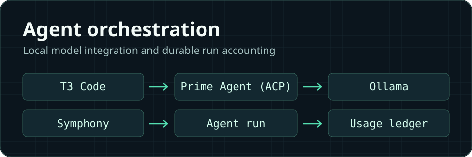

  

<h1 align="center">I build agent tooling and trading systems</h1>

  I’m working on local model integration in T3 Code and run accounting in Symphony. I also build Omni Terminal and its market data tooling.

  <a href="https://github.com/InTheta/t3code/tree/integration/prime-acp-base">T3 Code + Prime Agent</a> &nbsp;·&nbsp;
  <a href="https://github.com/InTheta/symphony">Symphony fork</a> &nbsp;·&nbsp;
  <a href="https://omniterminal.app/">Omni Terminal</a>

---

### Agent orchestration

| Project | What I worked on |
| --- | --- |
| [T3 Code + Prime Agent](https://github.com/InTheta/t3code/tree/integration/prime-acp-base) | Documented Prime Agent as a local ACP provider backed by Ollama. On Windows, Qwen read a disposable file and its checksum stayed the same. Also added validation for explicit MCP launch model options. [Setup and verification](https://github.com/InTheta/t3code/pull/1) · [Model validation](https://github.com/InTheta/t3code/pull/2) |
| [Symphony](https://github.com/InTheta/symphony) | Added persistence for per-issue token usage in my Elixir fork so totals can survive an orchestrator restart. [Implementation](https://github.com/InTheta/symphony/commit/46b7b9120beb648b78629fa75bab02a516e1c189) |

### Explore the code

| If you're interested in… | Start here |
| --- | --- |
| **Market data and trading integrations** | [Omni Universe SDKs](https://github.com/InTheta/omni-universe-sdks) has public SDKs, market-data examples and guarded trading agent examples. |
| **Agent permissions and payments** | [Agent Capability Middleware](https://github.com/InTheta/agent-capability-middleware) includes an SDK and reference profiles for user-controlled tool permissions, private context and x402 payment policies. |
| **Onchain strategy vaults** | [HL Vault SDK](https://github.com/InTheta/hl-vault-sdk) is a TypeScript SDK for Hyperliquid, HIP-3 and HIP-4 strategy vaults. |

### A closer look at upstream and fork contributions

- **IBKR daily bars were landing in 1970.** The Rust protobuf decoder read an eight-digit trading date as Unix seconds. I added calendar-date handling and a regression test, then checked the result with live MU daily bars from IB Gateway. [Merged upstream · rust-ibapi #625](https://github.com/wboayue/rust-ibapi/pull/625)
- **Omni needed an adapter for DefiLlama's Hyperliquid builder data.** I contributed the Omni Terminal builder adapter to the public dimension-adapters repository. [Merged upstream · DefiLlama #7627](https://github.com/DefiLlama/dimension-adapters/pull/7627)
- **Deribit options and combo support in C#.** I contributed nullable Greeks, option and instrument types, and fixes for combo parsing and nullable trade data. [DeriSock #27](https://github.com/psollberger/DeriSock/pull/27) · [DeriSock #44](https://github.com/psollberger/DeriSock/pull/44)
- **Binance futures funding in C#.** I added the futures funding stream to the WebSocket client. [Merged upstream](https://github.com/Marfusios/binance-client-websocket/pull/1)
